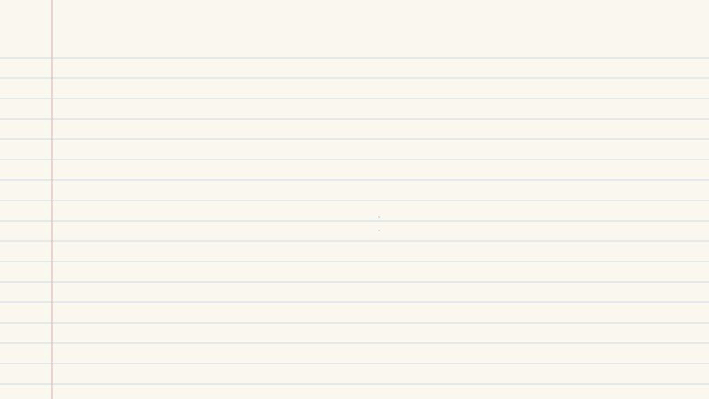
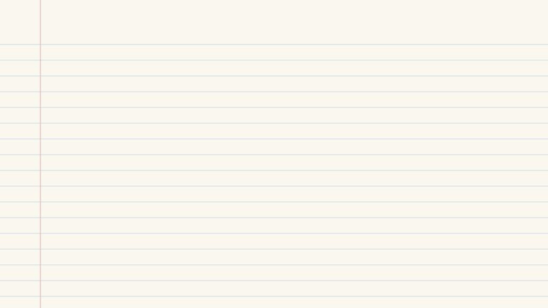
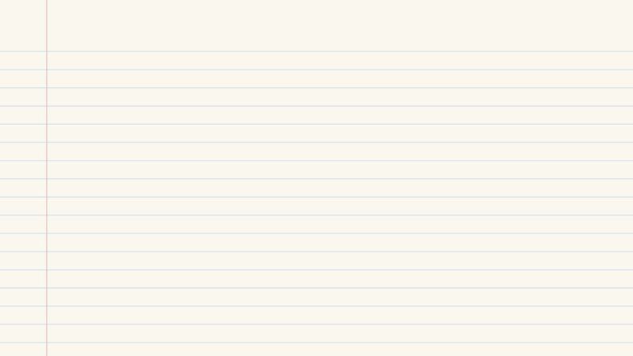
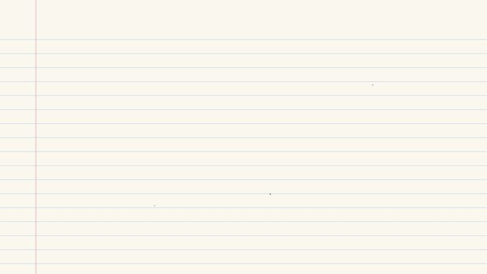

# latent-materials

> **Work in progress.** This is the training recipe as it stands, published early. A formal methodology, an evaluation harness and results will be added later; until then, treat numbers you get from it as your own measurements.

Games are mostly pictures. The surfaces in a game world (stone, wood, moss, metal) are each a *material*: a stack of texture images that tell the renderer what colour a surface is, which way its bumps face, how shiny it is and how high it rises. A big game ships tens of thousands of them, and they're most of what you download.

This project tries a different way to ship them: teach a small neural network to redraw the game's own textures from tiny codes, and download the codes instead of the pictures. Here is the idea in five drawings.

## 1. A material becomes a code



Think of describing a painting over the phone. You don't read out every brushstroke; you say "a green fern on dark soil, leaves pointing up", and someone who knows ferns paints it back. An **encoder** does the describing: it turns a material's four maps into a small grid of numbers, the **latent code**. A **decoder** does the painting: it turns the code back into the maps. The describing happens once, on our side. Players only need the codes and the painter.

<details><summary>The details</summary>

- The autoencoder is StableMaterials' material VAE (Vecchio et al. 2024): nine channels in (albedo RGB, normal XY, height, roughness, metallic, one unused), 18 latent channels out, at 1/8 the resolution. Normal Z is rebuilt from XY; ambient occlusion is not coded.
- Codes are coarse: a 1024 px material is encoded from a 512 px copy, giving a 64 × 64 × 18 grid, and the decoder makes the full-resolution detail.
- Codes are rounded at a fixed step and their size is the ideal code length under one Laplace distribution per channel, fitted on the library. In our runs that came to about 14 KiB per material.
- Code: `vae.py`, `fit.py`.
</details>

## 2. The decoder has to pay for itself



The painter isn't free: the decoder is a download too. Each material it paints saves a little, because its code is smaller than the picture it replaces. So the decoder starts in debt and pays it off one material at a time. Past a **break-even** number of materials, the codes plus the decoder are smaller than the pictures.

<details><summary>The details</summary>

- With decoder size `D`, code bytes per material `b` and the rival's bytes per material `s` (at the same rendered quality), the library is smaller once `N > N* = D / (s − b)`.
- The narrowed decoder has about 1.2M parameters: 2.4 MB at fp16, 1.2 MB at 8 bits.
- The fair rival is a strong image codec used the same way (download small, convert at install), such as AVIF, not the GPU textures games ship today, which are far larger.
- `latent-materials breakeven` does this accounting from fitted families, decoders included.
</details>

## 3. Overfitting on purpose



Most learned compression has to handle pictures it has never seen, so it can't get too attached to any of them. A game is different: it knows every texture it will ever ship. So we let the decoder get as attached as it likes. It's trained on exactly the textures it will decode, and judged only on those. In machine learning that's called overfitting, and here it's the goal.

<details><summary>The details</summary>

- Related work fits a network per image (COIN, COOL-CHIC) or a small decoder per material (NTC). We sit in between: one decoder shared by a family of materials.
- The encoder stays frozen; only the decoder is fine-tuned, on random aligned crops of the codes and maps, with MSE on every channel but ambient occlusion, LPIPS on albedo and a texture-statistics term. There is no held-out set: the decoder ships with its training data.
</details>

## 4. Families



One painter for everything has to know too many styles. A painter who only does stone walls gets very good at stone walls, and can be smaller. So we sort the library into **families** of look-alike materials and give each family its own small decoder. When the game installs, each material is painted once and saved in the ordinary GPU formats the game already uses. Nothing changes while you play.

<details><summary>The details</summary>

- Clustering uses texture statistics of the frozen encoder's features (channel means, spreads and Gram matrices of its first three blocks), z-scored, projected on 32 principal components and grouped with k-means++. Guards reject partitions with tiny or dominant families instead of training on them.
- Each family's decoder is the pretrained one narrowed (one residual block per stage, no middle block, 1/32 of the inner channels, 1 × 1 upsamplers) and then fine-tuned on that family. Decoding wraps at the edges, so textures tile without a seam.
- Install-time output would be BC7 (colour), BC5 (normals) and BC4 (masks) with mips; that step isn't in this repo yet.
- Code: `cluster.py`, `fit.py`. Families in the drawing are illustrative.
</details>

## 5. How we got here


We didn't start here. Each of these lost, and each loss pointed at the next step.

- **Colour pictures alone** lost to the GPU formats, so we code whole materials.
- **One decoder for a whole library** won big when the materials looked alike and only tied when they didn't, which is why there are families.
- **At the resolution games ship**, the win flipped to a loss until the codes were made coarser.
- **Painting on the fly while you play** was far too slow, so the painting happens once, at install.

<details><summary>The details</summary>

These are from our own experiments, which will be written up with the methodology; treat them as preliminary.

- Colour maps at 128 px: the best learned decoder needed about 1.75–2× ASTC 12 × 12's bytes at matched DISTS and PSNR.
- Whole materials on 64 MatSynth materials at 256 px: a shared small decoder needed 60–73% fewer bytes than AVIF at the same rendered DISTS or LPIPS; on a varied library it only tied.
- Resolution: the same comparison went from 17–39% fewer bytes than AVIF at 256 px to 66–150% more at 1024 px; coarse codes plus an in-library fine-tune brought it back.
- Runtime decoding on a GTX 1660 Ti: 2.56 s for a whole 1024 px material and 202 ms per 256 px tile, against a 50 ms budget.
</details>

## Try it

```sh
uv venv && uv pip install -e .        # pick the torch build for your GPU first if needed

latent-materials fetch --n 64                     # data/matsynth/<name>/{albedo,normal,orm,height}.png
latent-materials cluster --k 3                    # runs/families/family_<j>.txt
latent-materials fit --family runs/families/family_0.txt --out runs/fit/family_0
latent-materials decode --run runs/fit/family_0 --out decoded/family_0
latent-materials breakeven runs/fit/family_* --rival-bytes 29000
```

`configs/family.toml` holds the fit settings (narrowing, steps, losses, code step). Fitting needs a CUDA GPU in practice: 32k steps on 256 px crops per family. MatSynth's source maps are 4K, so fetching downloads several GB per hundred materials.

## Status and limits

- The recipe was developed on another material library; this MatSynth version has not yet been run end to end. Expect rough edges.
- There is no evaluation here yet. The comparison we rely on (lit renders scored with DISTS and LPIPS against AVIF swept to matched quality) will come with the methodology.
- Decoders are not yet sized to their families; every family gets the same cut.
- Codes lose detail finer than the latent grid, and PSNR is several dB below a conventional codec at the same perceptual score.
- StableMaterials' encoder was itself trained on MatSynth, so MatSynth is an easier case than unseen game textures.

## Licences

- Code: [GNU AGPL-3.0](LICENSE). For other licensing, contact the author.
- StableMaterials weights are downloaded from Hugging Face at a pinned revision under their own licence (OpenRAIL); they are not included here.
- MatSynth materials are fetched under their own per-material licences; `fetch` keeps CC0 by default and writes `licenses.csv` beside the data.
- The drawings in `docs/` are part of this repository and share its licence.

Outside contributions are not being accepted yet.

## References

- G. Vecchio, R. Martin, A. Roullier, A. Kaiser, R. Rouffet, V. Deschaintre, T. Boubekeur. *StableMaterials: Enhancing Diversity in Material Generation via Semi-Supervised Learning.* 2024.
- G. Vecchio, V. Deschaintre. *MatSynth: A Modern PBR Materials Dataset.* CVPR 2024.
- E. Dupont, A. Goliński, M. Alizadeh, Y. W. Teh, A. Doucet. *COIN: COmpression with Implicit Neural representations.* 2021.
- T. Ladune, P. Philippe, F. Henry, G. Clare, T. Leguay. *COOL-CHIC: Coordinate-based Low Complexity Hierarchical Image Codec.* ICCV 2023.
- K. Vaidyanathan, M. Salvi, B. Wronski, T. Akenine-Möller, P. Ebelin, A. Lefohn. *Random-Access Neural Compression of Material Textures.* SIGGRAPH 2023.
